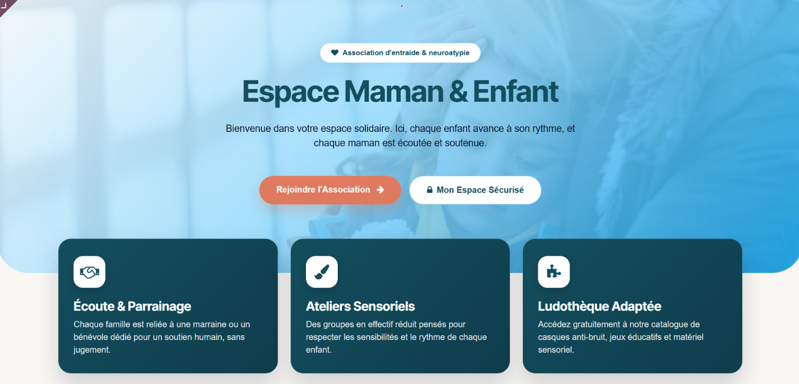
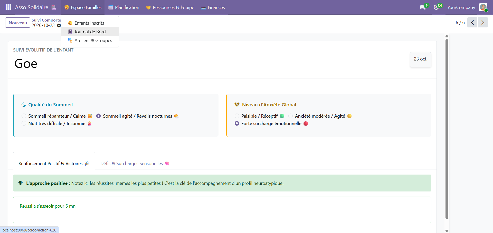
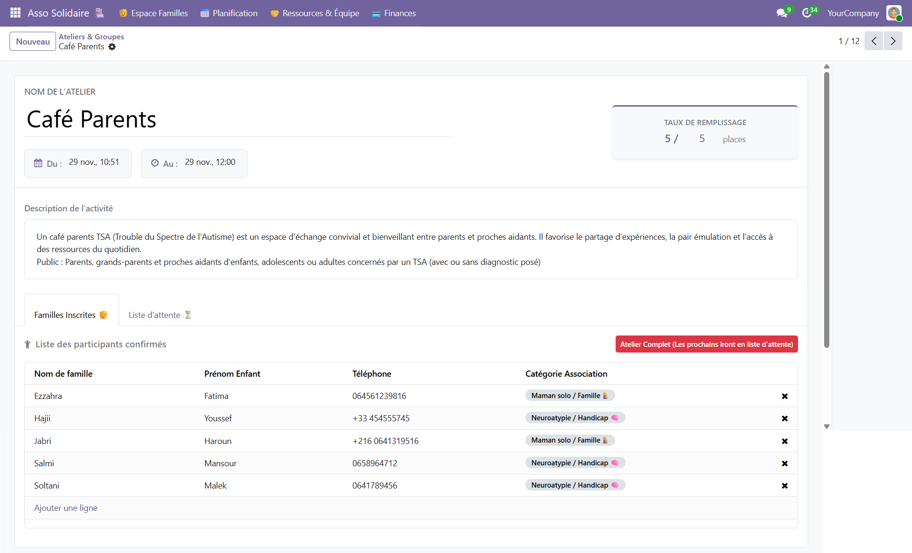
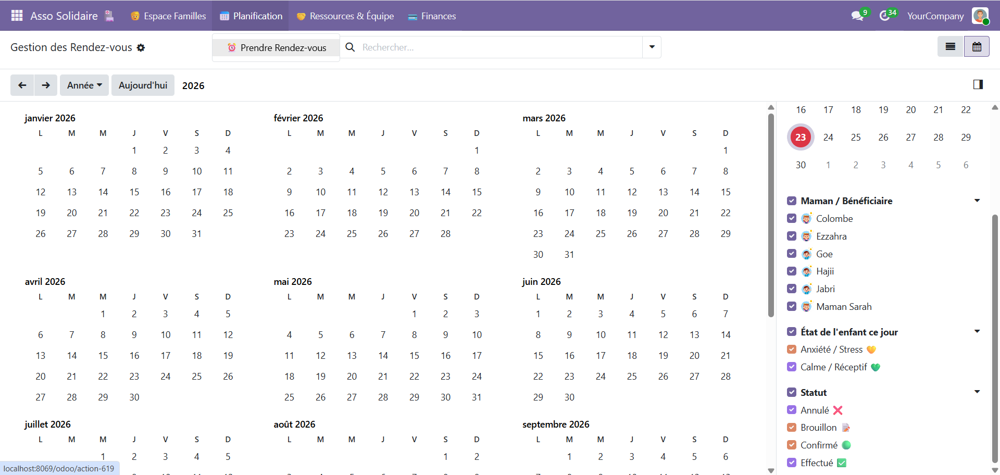
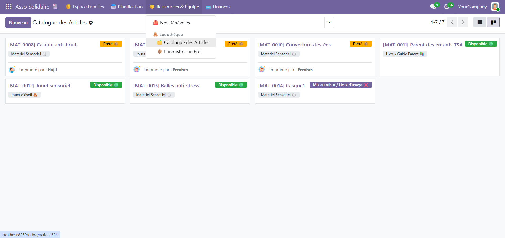
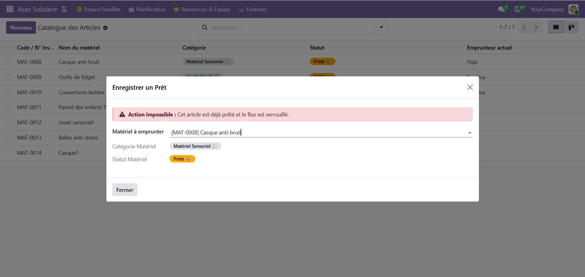
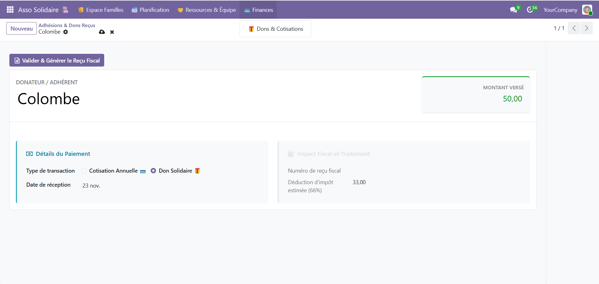

# 🏥 Association Solidaire : Prise de RDV & Suivi TSA (Odoo 19)

Application complète développée sous **Odoo 19** combinant un site web public, un portail membre unifié (Mamans & Bénévoles) et un back-office de gestion pour une association accompagnant les enfants avec troubles du neurodéveloppement (TSA).

## ✨ Fonctionnalités Principales

### 🌐 Site Web Public & Parcours d'Adhésion
* **Page d'accueil dédiée (`/mon-association`) :** Espace bienveillant présentant la mission de l'association.
* **Inscription en ligne (`/inscription-association`) :** Formulaire public avec choix d'avatar et création automatique d'une fiche bénéficiaire en statut `pending` (en attente de validation).

### 👩‍👦 Portail Unifié Multi-Rôles (`/my/appointments`)
Une interface unique à onglets qui s'adapte dynamiquement au profil de l'utilisateur connecté (**Maman**, **Bénévole**, ou **Double profil**) :
* **Espace Famille & Journal de Bord :**
  * Enrichissement du profil de l'enfant (hypersensibilités sensorielles, hyperfocus / centres d'intérêt, avatar dynamique).
  * Journal de bord quotidien : suivi du sommeil, du niveau d'anxiété, des défis et des **victoires** de l'enfant.
  * Inscription aux ateliers collectifs avec contrôle automatique des places disponibles (`capacity`).
* **Planning & Rendez-vous :**
  * Prise de rendez-vous en ligne avec attribution automatique du bénévole référent (`sponsor_id`), indication du niveau d'énergie de l'enfant et des besoins spécifiques du jour.
  * Annulation sécurisée depuis le portail.
* **Ludothèque & Bibliothèque Solidaire :**
  * Catalogue en ligne filtrant les articles endommagés.
  * Emprunt en un clic avec historisation (`association.resource.loan.history`) et suivi des retards.
  * Gestion des retours réservée aux profils bénévoles.
* **Espace Bénévoles & Cotisations :**
  * Saisie des heures de bénévolat (`timesheet`) depuis le portail.
  * Suivi des familles parrainées et vérification annuelle du statut d'adhésion (`membership_active`) et des dons.

## 🛠️ Architecture Technique

* **Version Odoo :** 19.0
* **Dépendances :** `base`, `web`, `mail`, `calendar`
* **Backend (7 modèles métier) :** `association.beneficiary`, `association.appointment`, `association.child.log`, `association.activity`, `association.resource`, `association.contribution`, `association.timesheet`.
* **Contrôleurs HTTP (`controllers/main.py`) :** 11 routes sécurisées (`auth='public'` et `auth='user'`, protection `csrf=True`).
* **Frontend :** Templates QWeb Website & feuilles de style CSS personnalisées (`web.assets_frontend`).
* **Sécurité :** Groupes utilisateurs dédiés (`security/association_security.xml`) et règles d'accès (`ir.model.access.csv`).

## 📸 Aperçu de l'application

### 1. Portail Web Public & Parcours d'Adhésion
*Page d'accueil bienveillante présentant les pôles de l'association (Écoute, Ateliers Sensoriels, Ludothèque) et l'accès sécurisé.*


### 2. Journal de Bord Évolutif & Renforcement Positif
*Suivi quotidien personnalisé (sommeil, niveau d'anxiété) mettant l'accent sur les réussites et petites victoires de l'enfant.*


### 3. Gestion des Ateliers & Capacités d'Accueil
*Organisation des groupes de parole (ex: Café Parents) avec suivi des participants et gestion des listes d'attente.*


### 4. Planification & Calendrier Intelligent
*Vue calendrier filtrable par famille, statut du rendez-vous et état émotionnel de l'enfant le jour de la séance.*


### 5. Ludothèque Solidaire (Vue Kanban & Contrôles)
*Suivi visuel en temps réel de l'état du matériel sensoriel (Disponible, Prêté, Hors d'usage) et de l'emprunteur actuel.*


### 6. Sécurisation des Prêts (Wizard & Contraintes Métier)
*Assistant de prêt intégrant un verrouillage automatique empêchant la double attribution d'un article déjà emprunté.*


### 7. Gestion Financière & Reçus Fiscaux
*Suivi des cotisations annuelles et des dons avec calcul automatique de la déduction fiscale (66 %) et génération de reçu.*



## 🚀 Installation

1. Cloner ce dépôt dans votre répertoire `custom_addons` :
   ```bash
   git clone https://github.com
   ```
2. Redémarrer le serveur Odoo et mettre à jour la liste des applications.
3. Rechercher **Association Solidaire : Prise de RDV** et cliquer sur **Installer**.

---
*Développé par Takwa — Ingénieure Informatique & Développeuse Odoo*
